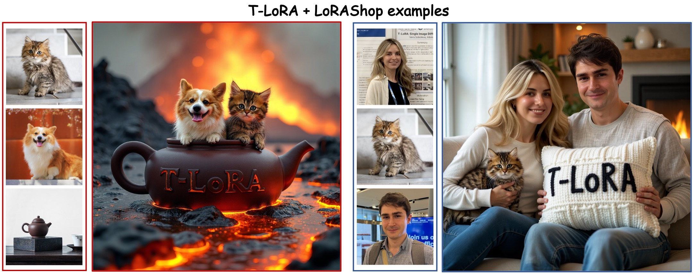

# T-LoRA PEFT implementation with Multi-concept generation support



This is the **PEFT branch** of T-LoRA — the original T-LoRA method re-implemented on top of 🤗 [PEFT](https://github.com/huggingface/peft) and 🤗 [Diffusers](https://github.com/huggingface/diffusers), with a ready-to-use [LoRAShop](https://github.com/gemlab-vt/LoRAShop.git) integration for multi-concept generation:

| | Original T-LoRA (`main`) | This branch (`peft`) |
|---|---|---|
| Backend | Custom LoRA implementation | 🤗 PEFT `LoraConfig` + custom layer |
| Training scripts | Custom `run.py` / `train.py` | Diffusers `train_dreambooth_tlora_*.py` |
| Adapter format | `.pt` checkpoint | PEFT-native (safetensors + metadata) |
| Multi-adapter | Not supported | Built-in (`load_adapter`, `set_adapter`) |
| Model support | FLUX.1-dev, SD-XL | FLUX.1-dev, SD-XL (easily extensible) |
| [LoRAShop](https://github.com/gemlab-vt/LoRAShop) | — | Ready-to-use integration script |

> Looking for the original implementation? Switch to the [`main`](https://github.com/ControlGenAI/T-LoRA/tree/main) branch.

## 📌 Prerequisites

- Linux
- NVIDIA GPU + CUDA (H100 / A100 recommended)
- Python 3.11+

## 📌 Setup

```bash
git clone https://github.com/ControlGenAI/T-LoRA.git -b peft
cd T-LoRA
pip install -r requirements.txt
```

## Repository structure

```
T-LoRA/
├── tlora_peft/                       # Core library
│   ├── __init__.py
│   ├── layer.py                      # TLoRALinear, TLoRAOrthoLinear
│   └── utils.py                      # Wrapping, timestep control, save/load
│
├── train_dreambooth_tlora_flux.py     # Training script for FLUX.1-dev
├── train_dreambooth_tlora_sdxl.py     # Training script for SD-XL
│
├── inference_tlora_flux.py           # Single-concept inference (FLUX)
├── inference_tlora_sdxl.py           # Single-concept inference (SD-XL)
└── inference_tlorashop.py            # Multi-concept inference with 
```

---

## T-LoRA on FLUX.1-dev

### Training

```bash
export MODEL_NAME="black-forest-labs/FLUX.1-dev"
export INSTANCE_DIR="dog_example"
export OUTPUT_DIR="trained-flux-tlora_dog"

accelerate launch train_dreambooth_tlora_flux.py \
  --pretrained_model_name_or_path=$MODEL_NAME \
  --instance_data_dir=$INSTANCE_DIR \
  --output_dir=$OUTPUT_DIR \
  --instance_prompt="a photo of sks dog" \
  --validation_prompt="a sks dog in the jungle" \
  --num_validation_images=1 \
  --resolution=1024 \
  --max_train_steps=1000 \
  --checkpointing_steps=100 \
  --rank=32 \
  --tlora \
  --min_rank=1 \
  --one_image="02.jpg"
```

Defaults used above (from `train_dreambooth_tlora_flux.py`) — change if needed:

- `--optimizer=prodigy`, `--learning_rate=1.0`, `--lr_scheduler=constant`
- `--mixed_precision=bf16`, `--train_batch_size=1`, `--gradient_accumulation_steps=1`
- `--max_grad_norm=1.0`, `--weighting_scheme=none`
- `--rank=32`, `--min_rank=1` (LoRA alpha defaults to rank, i.e. effective scale = 1.0)

Data pipeline (matches the original [`main`](https://github.com/ControlGenAI/T-LoRA/tree/main) branch):

- If `--mask_dir` is provided, then the masked diffusion loss will be used for training

**With masked loss** (recommended for people):

```bash
accelerate launch train_dreambooth_tlora_flux.py \
  ... \
  --mask_dir="path/to/masks" \
  --tlora \
  --min_rank=1
```

Masks can be obtained via [Personalize-Anything](https://github.com/fenghora/personalize-anything/tree/main/scripts). Mask filenames must match the corresponding image filenames.

### Inference

```bash
python inference_tlora_flux.py \
  --adapter_path=$OUTPUT_DIR \
  --prompt="a sks dog riding a bike" \
  --seed=42 \
  --num_inference_steps=28 \
  --guidance_scale=3.5 \
  --width=1024 --height=1024 \
  --output_path="result.png"
```

### Output structure

```
trained-flux-tlora_dog/
├── adapter_model.safetensors    # Trainable adapter weights
├── adapter_config.json          # LoRA hyperparameters
├── tlora_meta.json              # T-LoRA metadata (min_rank, max_timestep, ...)
├── tlora_frozen.pt              # Frozen SVD copies (ortho only)
├── checkpoint-500/
│   ├── adapter_model.safetensors
│   ├── adapter_config.json
│   ├── tlora_meta.json
│   └── tlora_frozen.pt
└── ...
```

---

## T-LoRA on SD-XL

### Training

```bash
export MODEL_NAME="stabilityai/stable-diffusion-xl-base-1.0"
export VAE_NAME="madebyollin/sdxl-vae-fp16-fix"
export INSTANCE_DIR="dog_example"
export OUTPUT_DIR="trained-sdxl-tlora_dog"

accelerate launch train_dreambooth_tlora_sdxl.py \
  --pretrained_model_name_or_path=$MODEL_NAME \
  --pretrained_vae_model_name_or_path=$VAE_NAME \
  --instance_data_dir=$INSTANCE_DIR \
  --output_dir=$OUTPUT_DIR \
  --instance_prompt="a photo of sks dog" \
  --validation_prompt="a sks dog in the jungle" \
  --num_validation_images=1 \
  --resolution=1024 \
  --mixed_precision="no" \
  --max_train_steps=800 \
  --checkpointing_steps=200 \
  --optimizer="AdamW" \
  --learning_rate=1e-4 \
  --rank=64 \
  --tlora \
  --min_rank=32 \
  --one_image="02.jpg"
```

> SD-XL T-LoRA is trained with **AdamW + `lr=1e-4`** (same as the original [`main`](https://github.com/ControlGenAI/T-LoRA/tree/main) branch). The `--optimizer` / `--learning_rate` flags above override the generic Prodigy defaults inherited from the Diffusers example script.

Other defaults used above (from `train_dreambooth_tlora_sdxl.py`):

- `--pretrained_vae_model_name_or_path=madebyollin/sdxl-vae-fp16-fix` (fp16-stable VAE, same as the original branch)
- `--lr_scheduler=constant`
- `--mixed_precision=no` (train in full fp32, matching the original branch), `--train_batch_size=1`, `--gradient_accumulation_steps=1`
- `--max_grad_norm=1.0`, `--image_interpolation_mode=lanczos`
- `--adam_beta1=0.9`, `--adam_beta2=0.999`, `--adam_weight_decay=1e-4`, `--adam_epsilon=1e-8`
- `--rank=64`, `--min_rank=32`

**Orthogonal T-LoRA** on SD-XL:

```bash
accelerate launch train_dreambooth_tlora_sdxl.py \
  ... \
  --rank=64 \
  --tlora \
  --tlora_ortho \
  --min_rank=32 \
  --sig_type="last"
```

### Inference

```bash
python inference_tlora_sdxl.py \
  --adapter_path=$OUTPUT_DIR \
  --prompt="a sks dog dressed as a ballerina" \
  --seed=42 \
  --num_inference_steps=25 \
  --guidance_scale=5.0 \
  --width=1024 --height=1024 \
  --output_path="result.png"
```

The SD-XL inference script loads `madebyollin/sdxl-vae-fp16-fix` and runs the whole pipeline in `float32` (matching the original branch) for full determinism. Override with `--pretrained_vae_model_name_or_path=...` if you want a different VAE.

---

## Multi-concept generation with T-LoRA and LoRAShop

T-LoRA adapters can be used with [LoRAShop](https://github.com/gemlab-vt/LoRAShop.git) for multi-concept image generation, combining T-LoRA's timestep-dependent rank masking with LoRAShop's block-blended denoising.

### Setup

Clone LoRAShop alongside this repo (or set `LORASHOP_DIR`):

```bash
git clone https://github.com/gemlab-vt/LoRAShop.git
```

### Multi-concept inference

```bash
python inference_tlorashop.py \
  --pretrained_model_name_or_path=black-forest-labs/FLUX.1-dev \
  --adapter_paths trained-adapter_A trained-adapter_B \
  --prompt "a photo of sks_A dog and sks_B cat playing together" \
  --target_prompts "sks_A dog" "sks_B cat" \
  --num_inference_steps=50 \
  --guidance_scale=3.5 \
  --seed=42 \
  --output_path="multi_concept.png"
```

Each `--target_prompt` must be a substring of `--prompt` and corresponds to one adapter in order. 

---

## Using `tlora_peft` as a library

T-LoRA can be applied to any model that supports 🤗 PEFT:

```python
from peft import LoraConfig
from tlora_peft import get_tlora_peft_model, set_timestep, enable_timestep_hook

config = LoraConfig(r=32, lora_alpha=32, target_modules=["to_q", "to_k", "to_v", "to_out.0"])

# Standard T-LoRA
model = get_tlora_peft_model(model, config, min_rank=1, max_timestep=1000)

# Orthogonal T-LoRA
model = get_tlora_peft_model(model, config, min_rank=1, ortho=True, sig_type="last")

# Option A: manual timestep control (training loop)
set_timestep(model, current_timestep)
output = model(noisy_input, timestep=t, ...)

# Option B: automatic hook (inference with any Diffusers pipeline)
hook = enable_timestep_hook(pipe.transformer, timestep_scale=1000.0)  # Flux
# hook = enable_timestep_hook(pipe.unet, timestep_scale=1.0)         # SD-XL
image = pipe(prompt=..., generator=...).images[0]
hook.remove()
```

### Save & load

```python
import torch
from tlora_peft import (
    save_tlora_adapter,
    load_tlora_weights,
    enable_timestep_hook,
    cast_tlora_adapter_dtype,
)

# After training
save_tlora_adapter(model, "output/my_adapter")

# For inference: wrap + load adapter weights (+ T-LoRA metadata) in one call
pipe.transformer = load_tlora_weights(pipe.transformer, "output/my_adapter")

# Optional: run the LoRA branch in fp32 while keeping the base in bf16.
# Required to reproduce the old FLUX T-LoRA numerics exactly.
cast_tlora_adapter_dtype(pipe.transformer, torch.float32)

hook = enable_timestep_hook(pipe.transformer, timestep_scale=1000.0)
```

### Multi-adapter management

Use `load_tlora_weights` for the **first** adapter (it wraps the base model
with T-LoRA layers) and `load_adapter` for each subsequent adapter:

```python
from tlora_peft import (
    load_tlora_weights,
    load_adapter,
    set_adapter,
    remove_adapter,
    list_adapters,
)

# First adapter → wraps pipe.transformer into a T-LoRA PeftModel
peft_model = load_tlora_weights(pipe.transformer, "path/to/adapter_A", adapter_name="dog")

# Additional adapter(s) → attach onto the already-wrapped model
load_adapter(peft_model, "path/to/adapter_B", adapter_name="cat")

# Put the wrapped transformer back into the pipeline
pipe.transformer = peft_model.base_model.model

list_adapters(peft_model)    # -> {"dog": {"rank": 32, "min_rank": 1}, "cat": {...}}

set_adapter(peft_model, "dog")            # activate one adapter
set_adapter(peft_model, ["dog", "cat"])   # or several at once (e.g. with LoRAShop)
remove_adapter(peft_model, "dog")         # free memory
```

> Note: all adapters loaded this way share the same set of `target_modules`
> (inferred from the first adapter's `adapter_config.json`). Mixing adapters
> trained on different layer sets is not supported.

---

## 🙏 Acknowledgements
We sincerely thank the 🤗 [Huggingface](https://huggingface.co) community for their open-source code and contributions. Training scripts are adapted from the [Diffusers examples](https://github.com/huggingface/diffusers/tree/main/examples/dreambooth). We also thank the authors of [LoRAShop](https://github.com/gemlab-vt/LoRAShop) for their block-blended multi-concept generation pipeline, which powers our `inference_tlorashop.py` script.

## 📌 Citation

If our work assists your research, feel free to give us a star ⭐ and cite us using:
```
@misc{soboleva2025tlorasingleimagediffusion,
      title={T-LoRA: Single Image Diffusion Model Customization Without Overfitting}, 
      author={Vera Soboleva and Aibek Alanov and Andrey Kuznetsov and Konstantin Sobolev},
      year={2025},
      eprint={2507.05964},
      archivePrefix={arXiv},
      primaryClass={cs.CV},
      url={https://arxiv.org/abs/2507.05964}, 
}
```
